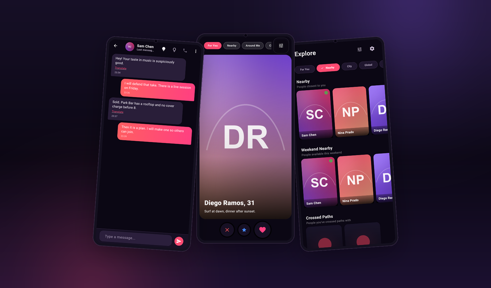
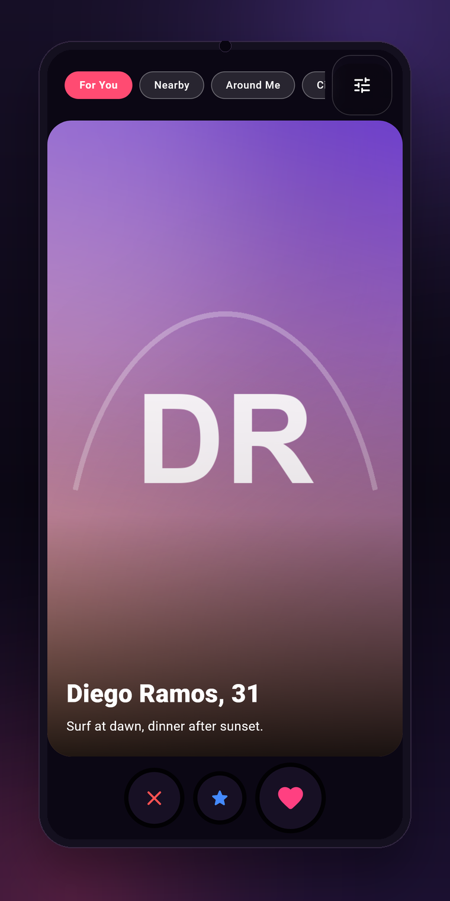
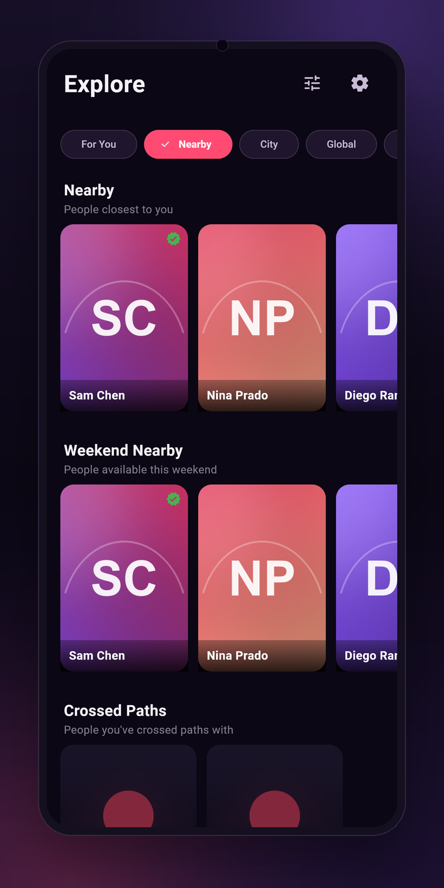
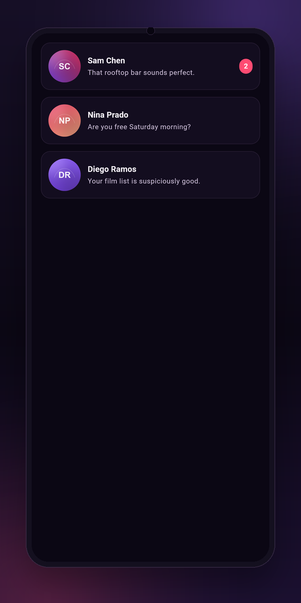
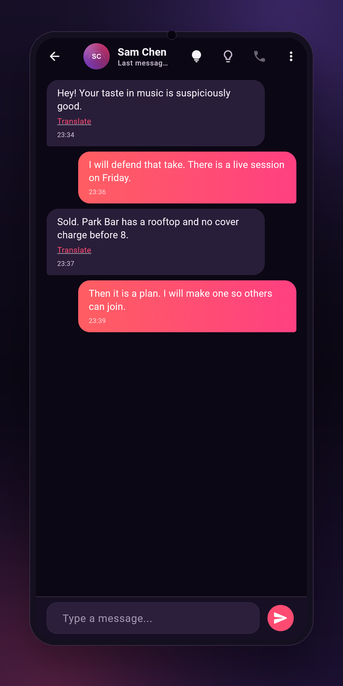
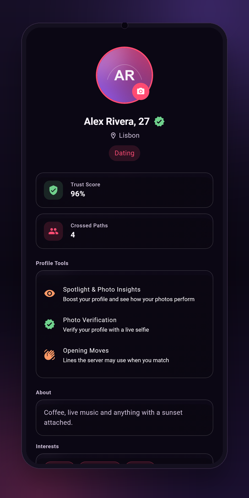
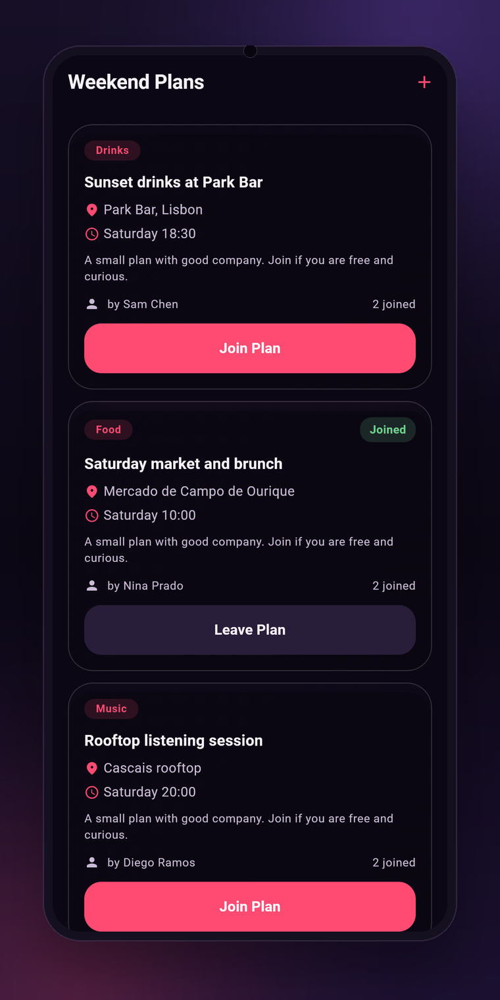

# Weekend

### Make Every Weekend Brighter.

**Discover people nearby. Find your connection. Turn conversations into real plans.**

A free, open source dating app for Android, with social discovery built in.

[Download APK](https://github.com/zypherlabs-bit/Weekend/releases/download/v2.8.5/app-release.apk)
· [Test builds](https://github.com/zypherlabs-bit/Weekend/releases/latest)
· [Screenshots](#app-preview)
· [Documentation](docs/README.md)
· [Source code](https://github.com/zypherlabs-bit/Weekend/tree/master/lib)
· [Report a bug](https://github.com/zypherlabs-bit/Weekend/issues/new?template=bug_report.md)

     

---

## App preview

<table>
  <tr>
    <td width="33%" align="center"> Discover</td>
    <td width="33%" align="center"> Explore</td>
    <td width="33%" align="center"> Matches</td>
  </tr>
  <tr>
    <td width="33%" align="center"> Chat</td>
    <td width="33%" align="center"> Profile</td>
    <td width="33%" align="center"> Weekend Plans</td>
  </tr>
</table>

---

## Why Weekend

| Area | What it does |
|------|--------------|
| **Discover** | Meet people around you. |
| **Match** | Connect through shared interests. |
| **Chat** | Start real conversations. |
| **Plans** | Turn connections into real experiences. |

---

## Key features

| Feature | What it does |
|---------|--------------|
| Location-based discovery | Nearby people ranked by real distance. |
| Advanced matching | Server-side filters for age, distance, intent and interests. |
| Real-time messaging | Live chat between matches. |
| Weekend Plans | Create and join small plans. * |
| QR invitations | Share a signed invite and scan one in-app. |
| Biometric app lock | Lock the app with biometrics or device credential. |
| Privacy controls | Incognito, snooze, away notes and travel mode. |
| Blocking and reporting | Block anyone, or report them to moderators. |
| Profile verification | Selfie photo verification and moderation. |
| Day, Night and Auto themes | Light, dark, or follow the system. |

* The Plans screen is complete and wired to the database, but its entry point is not yet exposed in the shipped app. See [Known limitations](#known-limitations).

### QR invitations

Every invitation carries an HMAC-signed, expiring payload and a referral code. Scan it in-app to redeem it. Full behaviour, threat model and the server-side validation rules live in [docs/qr-invitations.md](docs/qr-invitations.md).

---

## Privacy and safety

| Protection | How it works |
|------------|--------------|
| Server-side access control | Row Level Security on every table, with `search_path` pinned on helper functions. |
| Location privacy | Geohash buckets and server-side distance. Exact coordinates are never shared between users. |
| Account security | TOTP two-factor, biometric app lock, encrypted local storage, HTTPS-only traffic. |
| Blocking and reporting | Block or unmatch instantly; report for moderator review. |
| Secure account deletion | Deletion runs server-side and removes your account data. |
| Data transparency | Privacy policy, terms and a third-party SDK inventory are published in `docs/`. |

Beyond the table above, the Android build blocks screenshots of the app window, refuses to show protected content while a VPN is active, and stores session material in the Android Keystore.

Privacy details: [docs/privacy.md](docs/privacy.md) · Security model: [docs/security.md](docs/security.md) · Safety policy: [docs/safety-policy.md](docs/safety-policy.md)

---

## Quick start

1. **Download** the APK from the [latest release](https://github.com/zypherlabs-bit/Weekend/releases/latest). Current version: v2.8.5
2. **Install** it — allow installs from unknown sources the first time.
3. **Create a profile** — add photos, a few interests and how you describe yourself.
4. **Discover and connect** — nearby people appear first; like, match, chat and make a plan.

Full setup, permissions and troubleshooting: [docs/installation.md](docs/installation.md)

---

## Technology

| Layer | Technology |
|-------|------------|
| App | Flutter 3.41.9, Dart 3.11.5, Riverpod, GoRouter |
| Android host | Kotlin, Gradle Kotlin DSL, JDK 17, Android 7.0+ (API 24) |
| Backend | Supabase — Auth, PostgreSQL + PostGIS, Storage, Realtime, Edge Functions |
| Security | Row Level Security, `assert_self` helpers, pinned `search_path` |
| Delivery | GitHub Actions — analyze, test, signed release builds |

Architecture walkthrough: [docs/architecture.md](docs/architecture.md)

---

## Known limitations

Documented honestly, so nothing here overstates what the code does today:

- **Weekend Plans** — the screen, database and join/leave logic are complete, but the entry point is not yet routed in the shipped app.
- **Passkeys** — the client implementation is complete; the live project still answers `passkey_disabled`, so passkey sign-in is off. Email and password with optional TOTP two-factor works.
- **Notifications** — the in-app notification centre works. Remote push (FCM) is not wired up yet.
- **Translation and icebreakers** — the Edge Functions exist and date ideas are surfaced in chat, but there is no translate-on-tap action in the chat UI.
- **Voice intros** — not implemented; the service exists but no screen records or uploads one.
- **Sign-in methods** — email and password only. No OAuth providers.
- **Platforms** — Android is built, released and tested. iOS is not released, and there is no web build.
- **Discovery modes** — the mode chips share one proximity query; a mode changes the context, not the SQL filter.

Everything above is tracked in the [Roadmap](#roadmap). Longer detail lives in [docs/product-feature-audit.md](docs/product-feature-audit.md).

---

## Roadmap

**Available**

- Nearby discovery with PostGIS distance, radius control and privacy-safe geohash buckets.
- Server-side hard filters for age, distance, gender, intent, interests, languages and lifestyle.
- Unlimited likes, passes and mutual matches, with a 24-hour match initiation window.
- Real-time messaging between matches, with away notes and match extension.
- Safety centre: block, unmatch, report, photo verification and privacy controls.
- QR invitations with signed, expiring payloads and in-app scanning.
- Biometric app lock, TOTP two-factor, encrypted local storage, screenshot protection and VPN-aware access control.
- Day, Night and Auto themes, glass design system, English-only UI.

**In progress**

- Exposing the Weekend Plans entry point in the shipped app.
- Enabling passkeys on the live project and verifying them on physical hardware.
- Translate-on-tap in chat and surfacing icebreakers in the UI.
- Voice intro recording and upload.

**Planned**

- Remote push notifications (FCM).
- Video profiles, additional sign-in providers and more languages.
- iOS and web builds.

Roadmap items are intentions, not commitments. Anything not merged into `master` should be treated as unshipped.

---

## Community

| I want to... | Do this |
|--------------|---------|
| Report a bug | [Open a bug report](https://github.com/zypherlabs-bit/Weekend/issues/new?template=bug_report.md) |
| Request a feature | [Open a feature request](https://github.com/zypherlabs-bit/Weekend/issues/new?template=feature_request.md) |
| Contribute code | [Read CONTRIBUTING.md](CONTRIBUTING.md), then open a pull request |
| Report a vulnerability | [Report it privately](https://github.com/zypherlabs-bit/Weekend/security/advisories/new) |
| Read the docs | [docs/README.md](docs/README.md) |

Please read the [Code of Conduct](CODE_OF_CONDUCT.md) before contributing.

---

**Weekend** — Make Every Weekend Brighter.

[Repository](https://github.com/zypherlabs-bit/Weekend) · [Releases](https://github.com/zypherlabs-bit/Weekend/releases) · [Documentation](docs/README.md) · [Security](SECURITY.md)

MIT License © 2026 Weekend — [LICENSE](LICENSE)

